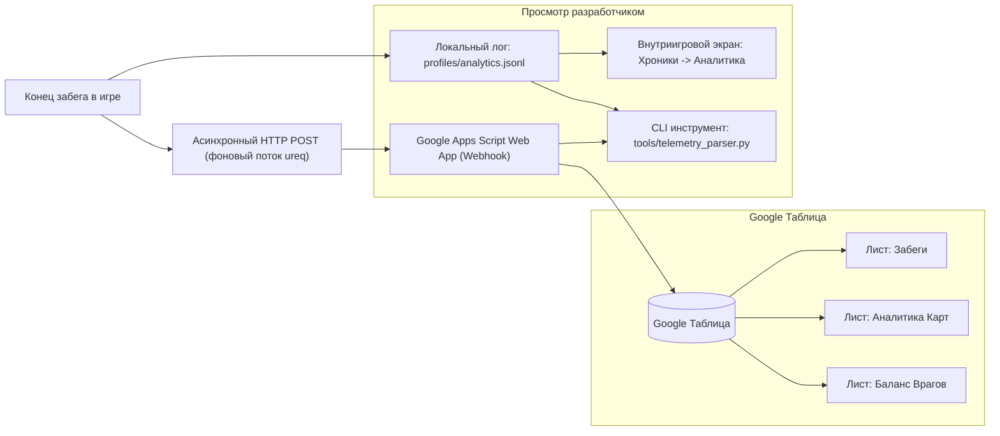

# Система телеметрии и балансной аналитики «Тропа в Навь»

## 1. Архитектура и назначение

Система телеметрии предназначена для сбора детальной игровой статистики забегов, отслеживания баланса карт, опасности врагов и обнаружения перекосов сложности (имбовые связки против слабых карт, непроходимые враги против «груш для битья»).



---

## 2. Формат данных телеметрии

Каждый забег сериализуется в JSON следующей структуры:

```json
{
  "run_id": "run_1710185920",
  "version": "0.1.8",
  "circle": 1,
  "act": 4,
  "floor": 19,
  "won": true,
  "heroes": ["ilya", "dobrynya"],
  "final_deck": ["strike_ilya", "shield_slam", "heavy_armor"],
  "relics": ["bogatyr_shield", "alatyr_shard"],
  "cards_played": {
    "strike_ilya": 24,
    "shield_slam": 12
  },
  "enemies_summary": {
    "kot_bayun": { "damage_dealt": 18, "hero_kills": 0 },
    "koschei": { "damage_dealt": 48, "hero_kills": 0 }
  }
}
```

---

## 3. Google Таблицы и Apps Script Webhook

Скрипт развёртывания находится в [`tools/google_sheets_telemetry.js`](file:///D:/grok-test/slaythespireclone/tools/google_sheets_telemetry.js).

### Автоматически формируемые листы:
1. **Лист «Забеги»**:
   - Полный журнал каждого сыгранного забега: дата, результат, круг, акт, этаж, состав отряда, финальная колода, реликвии, сводки по сыгранным картам и урону врагов.
2. **Лист «Аналитика Карт»**:
   - Агрегирует статистику по каждой карте: сколько раз брали в колоду, сколько побед, процент побед (`% Побед`), общее число розыгрышей в боях.
   - Автоматически выставляет статус баланса:
     - 🌟 **ИМБА** — взята $\ge 3$ раз, винрейт $\ge 65\%$.
     - 💀 **СЛАБАЯ** — взята $\ge 3$ раз, винрейт $\le 35\%$.
     - ⚖️ **В НОРМЕ** — в пределах нормы.
3. **Лист «Баланс Врагов»**:
   - Учитывает количество встреч, суммарный урон, средний урон за бой и число убитых героев.
   - Автоматически выставляет статус:
     - ☠️ **ГРОЗА ЗАБЕГОВ** — средний урон $\ge 35$ либо есть убийства героев.
     - 🥊 **ГРУША ДЛЯ БИТЬЯ** — средний урон $< 8$.
     - ⚖️ **СБАЛАНСИРОВАН** — сбалансированная угроза.

### Защита от одновременных запросов (`LockService`)
Для предотвращения race condition (когда несколько клиентов одновременно завершают забеги и отправляют телеметрию) в Google Apps Script используется механизм script-level блокировки:
```javascript
var lock = LockService.getScriptLock();
lock.waitLock(30000); // Ожидание очереди до 30 секунд
try {
  // Выполнение вставок и подсчетов
  SpreadsheetApp.flush(); // Гарантированный коммит данных
} finally {
  lock.releaseLock();
}
```

---

## 4. Конфигурация в игре

URL вебхука настраивается в файле [`assets/config.ron`](file:///D:/grok-test/slaythespireclone/assets/config.ron):

```ron
(
    steam_app_id: 480,
    telemetry_url: "https://script.google.com/macros/s/AKfycbxgtLECTC7pTGTBDl9vM5VWaqxCYq1J0TDC3ibGilgG7zooomVp3XZy0CiSAa4MOeFz/exec",
)
```

Также поддерживается переменная окружения:
```bash
set TROPA_TELEMETRY_URL=https://script.google.com/.../exec
```

> [!NOTE]
> Отправка телеметрии из игры выполняется в отдельном потоке (background thread) с таймаутом 5 секунд. При отсутствии интернета или сбое сети игра не зависает и не крашится, а данные продолжают сохраняться в локальный файл `profiles/analytics.jsonl`.

---

## 5. Внутриигровой дашборд аналитики

Игрок и разработчик могут просматривать статистику прямо в интерфейсе игры:
- Главное меню -> **Хроники** -> кнопка **Аналитика забегов**.
- Отображает общие метрики забегов, победы/поражения, а также таблицы баланса карт и врагов.

---

## 6. CLI-инструмент разработчика (`tools/telemetry_parser.py`)

Инструмент позволяет анализировать баланс в терминале без открытия браузера.

### Основные команды:

```bash
# 1. Быстрый локальный парсинг сохранённых забегов (profiles/analytics.jsonl):
python tools/telemetry_parser.py --local

# 2. Проверка связи с Google Apps Script вебхуком:
python tools/telemetry_parser.py --test-ping

# 3. Стресс-тест одновременной отправки и наполнение Google Таблицы тестовыми данными:
python tools/telemetry_parser.py --send-test-data --concurrent 6
```
